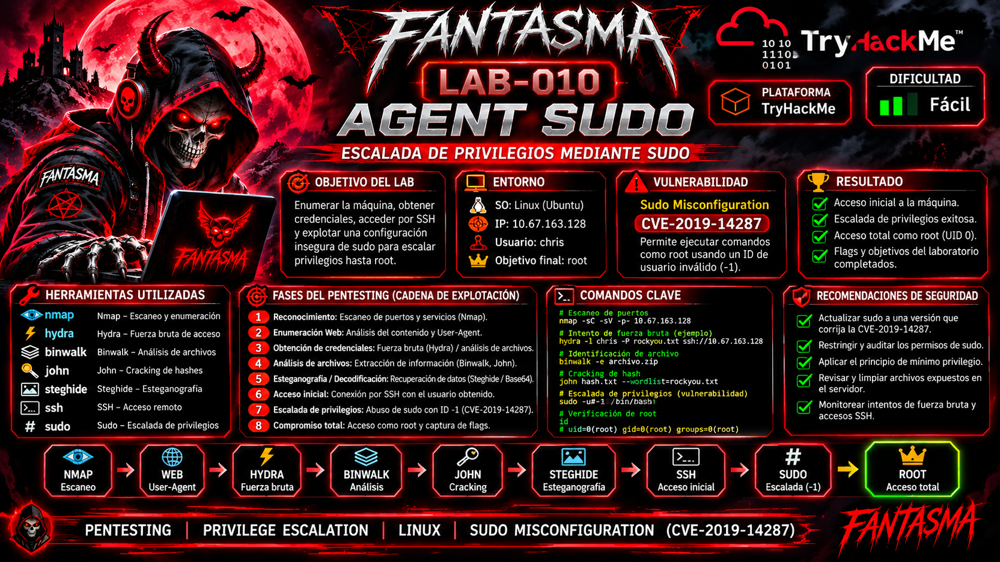

# LAB-010 — AGENT SUDO
### FANTASMA | Pentesting & Red Team



**Plataforma:** TryHackMe  
**Máquina:** Agent Sudo  
**Dificultad:** Fácil  
**Sistema operativo:** Ubuntu 18.04.3 LTS  
**Objetivo:** Obtener acceso inicial, recuperar las banderas y escalar privilegios a root.  
**Estado:** Completado

> Laboratorio realizado exclusivamente en un entorno autorizado de TryHackMe, con fines educativos.

## 1. Resumen ejecutivo

Durante este laboratorio se realizó una evaluación de seguridad de la máquina Agent Sudo.

El reconocimiento inicial identificó servicios FTP, SSH y HTTP. Mediante la manipulación de la cabecera HTTP User-Agent se descubrió el usuario `chris`.

Posteriormente se recuperaron credenciales FTP mediante un ataque de diccionario. El análisis de archivos descargados permitió identificar un ZIP cifrado y datos ocultos mediante esteganografía.

Finalmente, se obtuvo acceso SSH como `james` y se aprovechó una configuración vulnerable de sudo para conseguir privilegios root.

## 2. Información del objetivo

| Elemento | Información |
|---|---|
| Plataforma | TryHackMe |
| Laboratorio | Agent Sudo |
| IP de laboratorio | 10.67.163.128 |
| Sistema operativo | Ubuntu 18.04.3 LTS |
| Vulnerabilidad de escalada | CVE-2019-14287 |
| Resultado | Acceso root confirmado |

La dirección IP corresponde a una sesión temporal del laboratorio.

## 3. Herramientas utilizadas

- Nmap
- Curl
- Hydra
- FTP
- Binwalk
- 7-Zip
- John the Ripper
- Steghide
- Stegseek
- SSH
- Sudo

## 4. Reconocimiento

Se identificaron tres servicios principales:

| Puerto | Servicio | Versión |
|---|---|---|
| 21 | FTP | vsftpd 3.0.3 |
| 22 | SSH | OpenSSH 7.6p1 |
| 80 | HTTP | Apache 2.4.29 |

La aplicación web solicitaba utilizar un nombre en clave mediante la cabecera User-Agent.

La cabecera `User-Agent: C` permitió descubrir información relacionada con el usuario `chris`.

## 5. Acceso FTP

Se utilizó Hydra junto con el diccionario RockYou para evaluar la resistencia de la contraseña del usuario identificado.

Se obtuvo acceso FTP y se localizaron los siguientes archivos:

- `To_agentJ.txt`
- `cutie.png`
- `cute-alien.jpg`

## 6. Análisis de archivos

### 6.1 Análisis de PNG

Binwalk identificó un archivo ZIP incrustado en `cutie.png`.

El ZIP estaba protegido mediante cifrado AES. Se utilizó `zip2john` y John the Ripper para recuperar su contraseña.

### 6.2 Decodificación Base64

El documento extraído contenía una cadena codificada en Base64.

Su decodificación proporcionó la pista `Area51`.

### 6.3 Esteganografía

Se analizó `cute-alien.jpg` utilizando Steghide y Stegseek.

Stegseek recuperó un documento oculto que contenía información de acceso del usuario `james`.

## 7. Acceso inicial

Con las credenciales recuperadas se estableció una conexión SSH como `james`.

Se verificó el acceso al sistema y se recuperó la bandera de usuario.

## 8. Escalada de privilegios

La enumeración de permisos sudo mostró la siguiente configuración:

```text
(ALL, !root) /bin/bash
```

La versión instalada era `sudo 1.8.21p2`.

Se identificó la vulnerabilidad **CVE-2019-14287**, relacionada con la validación de identificadores de usuario en determinadas configuraciones sudo.

En el entorno autorizado se utilizó:

```bash
sudo -u#-1 /bin/bash
```

La comprobación posterior mostró:

```text
uid=0(root) gid=1000(james) groups=1000(james)
```

Se confirmó así la obtención de privilegios root.

## 9. Resultados

| Objetivo | Estado |
|---|---|
| Reconocimiento de servicios | Completado |
| Enumeración web | Completado |
| Acceso FTP | Completado |
| Análisis de archivos | Completado |
| Extracción esteganográfica | Completado |
| Acceso SSH | Completado |
| Bandera de usuario | Recuperada |
| Escalada a root | Completada |
| Bandera root | Recuperada |

Las banderas y demás evidencias se conservan en la documentación del laboratorio, según su clasificación pública o privada.

## 10. Recomendaciones de seguridad

1. Mantener sudo y los componentes del sistema actualizados.
2. Revisar las reglas sudoers y aplicar el principio de mínimo privilegio.
3. Evitar contraseñas débiles y reutilizadas.
4. Restringir el acceso a servicios innecesarios.
5. No almacenar credenciales dentro de archivos o imágenes accesibles.
6. Monitorizar los intentos de autenticación y los cambios de privilegios.

## 11. Estructura del repositorio

```text
LAB-010-AGENT-SUDO/
├── 01-Informes/
├── 02-Reconocimiento/
├── 03-Explotacion/
├── 04-Imagenes/
├── 05-Evidencias/
│   ├── publico/
│   └── privado/   (excluido de Git)
├── 06-Comandos/
├── README.md
└── .gitignore
```

## 12. Conclusiones

El laboratorio demuestra cómo una cadena de debilidades puede conducir al compromiso completo de un sistema.

Se practicaron técnicas de enumeración, análisis de archivos, recuperación de contraseñas, esteganografía, acceso remoto y escalada de privilegios.

**Resultado final:** compromiso completo de la máquina de laboratorio y acceso root verificado.

---

**FANTASMA — Pentesting & Red Team**  
*LAB-010 | Agent Sudo | TryHackMe*
